# ambientCG: Paving Stones materials

**22 assets from [ambientCG](https://ambientcg.com), dedicated to the public domain under [CC0](https://docs.ambientcg.com/license/).** Use them in any game, free or paid, and change them however you like; no credit is needed.

PBR materials as 1K and 2K JPG maps (colour, normal GL and DX, roughness, AO, displacement), one folder per resolution. 881.3 MB in all.

This is a copy kept by [zuujis-cc0](https://github.com/zuujis-cc0) so game makers can take single files from GitHub. It is not made by or affiliated with ambientCG: the originals, often in more formats and higher resolutions, are on [ambientcg.com](https://ambientcg.com). If they help you, consider [supporting ambientCG](https://www.patreon.com/ambientCG).

Every file is listed in [MANIFEST.tsv](MANIFEST.tsv) with its size and SHA-256. More free assets: [the Zuujis collection](https://github.com/zuujis-cc0/free-game-assets#readme).

| | | | |
| :-: | :-: | :-: | :-: |
| <a href="PavingStones048">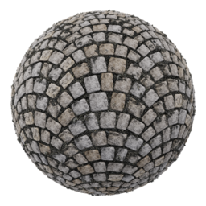</a> <b><a href="PavingStones048">Paving Stones 048</a></b> by ambientCG · <a href="https://ambientcg.com/a/PavingStones048">source</a> | <a href="PavingStones049">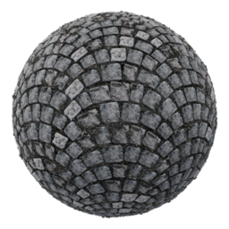</a> <b><a href="PavingStones049">Paving Stones 049</a></b> by ambientCG · <a href="https://ambientcg.com/a/PavingStones049">source</a> | <a href="PavingStones050">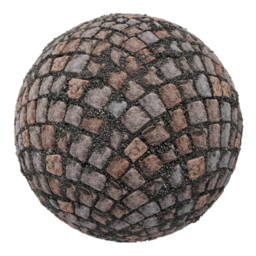</a> <b><a href="PavingStones050">Paving Stones 050</a></b> by ambientCG · <a href="https://ambientcg.com/a/PavingStones050">source</a> | <a href="PavingStones051">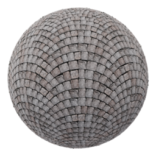</a> <b><a href="PavingStones051">Paving Stones 051</a></b> by ambientCG · <a href="https://ambientcg.com/a/PavingStones051">source</a> |
| <a href="PavingStones052">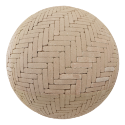</a> <b><a href="PavingStones052">Paving Stones 052</a></b> by ambientCG · <a href="https://ambientcg.com/a/PavingStones052">source</a> | <a href="PavingStones053">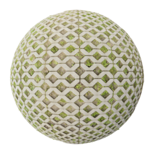</a> <b><a href="PavingStones053">Paving Stones 053</a></b> by ambientCG · <a href="https://ambientcg.com/a/PavingStones053">source</a> | <a href="PavingStones054">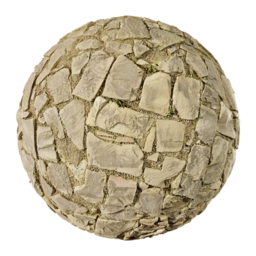</a> <b><a href="PavingStones054">Paving Stones 054</a></b> by ambientCG · <a href="https://ambientcg.com/a/PavingStones054">source</a> | <a href="PavingStones055">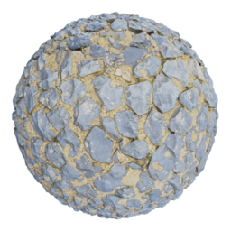</a> <b><a href="PavingStones055">Paving Stones 055</a></b> by ambientCG · <a href="https://ambientcg.com/a/PavingStones055">source</a> |
| <a href="PavingStones056">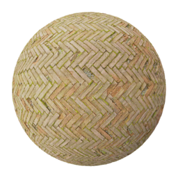</a> <b><a href="PavingStones056">Paving Stones 056</a></b> by ambientCG · <a href="https://ambientcg.com/a/PavingStones056">source</a> | <a href="PavingStones057">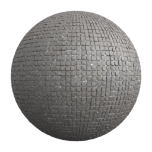</a> <b><a href="PavingStones057">Paving Stones 057</a></b> by ambientCG · <a href="https://ambientcg.com/a/PavingStones057">source</a> | <a href="PavingStones058">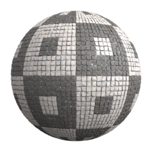</a> <b><a href="PavingStones058">Paving Stones 058</a></b> by ambientCG · <a href="https://ambientcg.com/a/PavingStones058">source</a> | <a href="PavingStones059">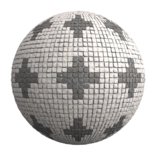</a> <b><a href="PavingStones059">Paving Stones 059</a></b> by ambientCG · <a href="https://ambientcg.com/a/PavingStones059">source</a> |
| <a href="PavingStones060">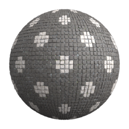</a> <b><a href="PavingStones060">Paving Stones 060</a></b> by ambientCG · <a href="https://ambientcg.com/a/PavingStones060">source</a> | <a href="PavingStones061">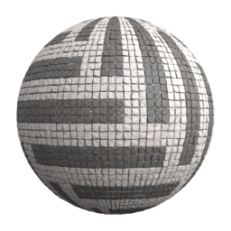</a> <b><a href="PavingStones061">Paving Stones 061</a></b> by ambientCG · <a href="https://ambientcg.com/a/PavingStones061">source</a> | <a href="PavingStones062">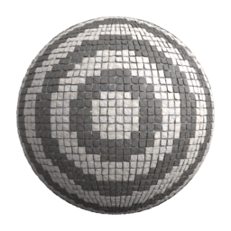</a> <b><a href="PavingStones062">Paving Stones 062</a></b> by ambientCG · <a href="https://ambientcg.com/a/PavingStones062">source</a> | <a href="PavingStones063">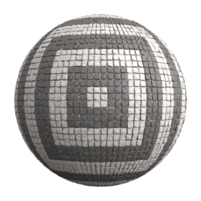</a> <b><a href="PavingStones063">Paving Stones 063</a></b> by ambientCG · <a href="https://ambientcg.com/a/PavingStones063">source</a> |
| <a href="PavingStones064">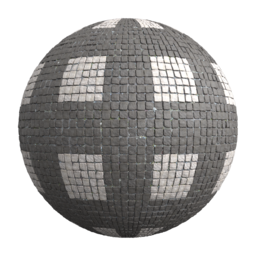</a> <b><a href="PavingStones064">Paving Stones 064</a></b> by ambientCG · <a href="https://ambientcg.com/a/PavingStones064">source</a> | <a href="PavingStones065">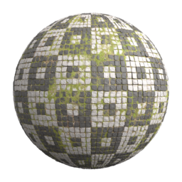</a> <b><a href="PavingStones065">Paving Stones 065</a></b> by ambientCG · <a href="https://ambientcg.com/a/PavingStones065">source</a> | <a href="PavingStones066">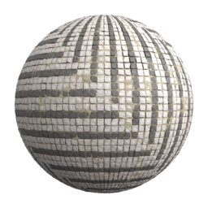</a> <b><a href="PavingStones066">Paving Stones 066</a></b> by ambientCG · <a href="https://ambientcg.com/a/PavingStones066">source</a> | <a href="PavingStones067">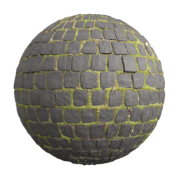</a> <b><a href="PavingStones067">Paving Stones 067</a></b> by ambientCG · <a href="https://ambientcg.com/a/PavingStones067">source</a> |
| <a href="PavingStones068">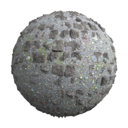</a> <b><a href="PavingStones068">Paving Stones 068</a></b> by ambientCG · <a href="https://ambientcg.com/a/PavingStones068">source</a> | <a href="PavingStones069">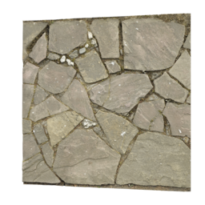</a> <b><a href="PavingStones069">Paving Stones 069</a></b> by ambientCG · <a href="https://ambientcg.com/a/PavingStones069">source</a> |  |  |

---

Kept up to date by this repository's own [update workflow](.github/workflows/update.yml), with code and plan from [cc0-mirror](https://github.com/zuujis-cc0/cc0-mirror). Something wrong? [Open an issue there](https://github.com/zuujis-cc0/cc0-mirror/issues/new) or use the [private report form](https://games.zuujis.com/report).
